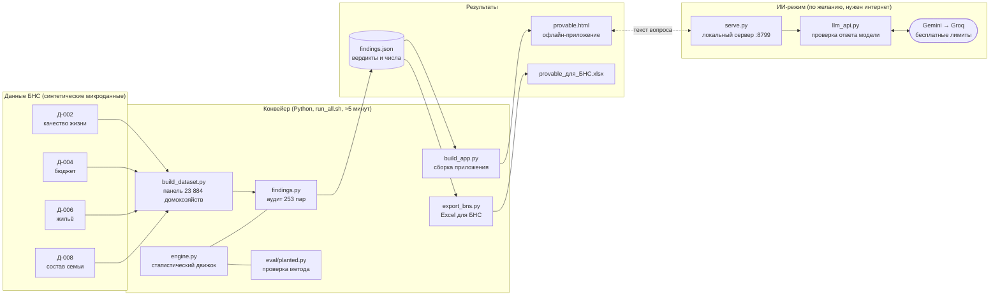
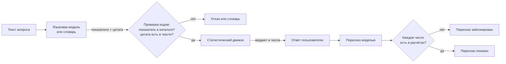
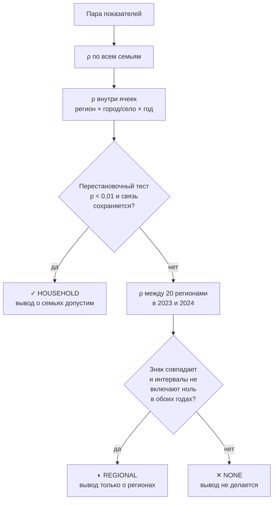
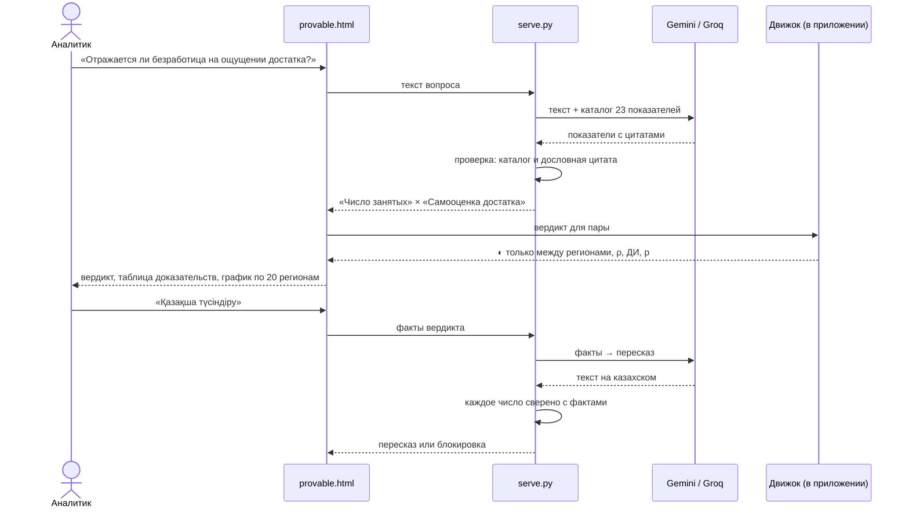
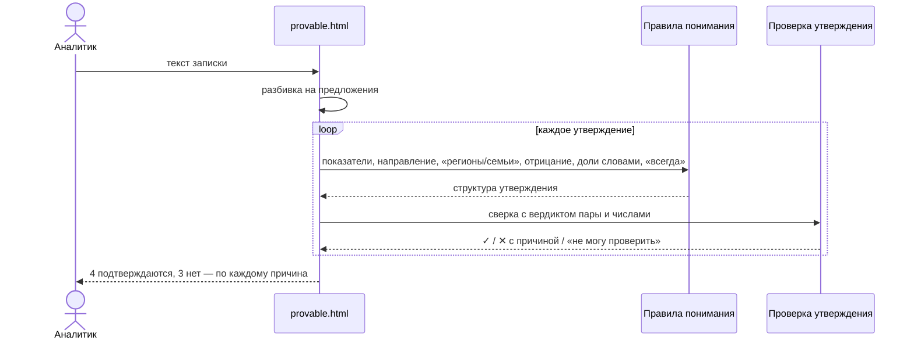
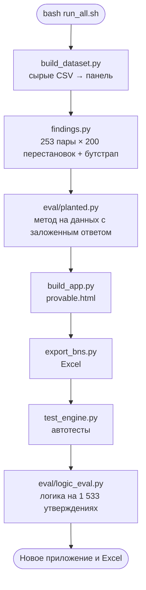
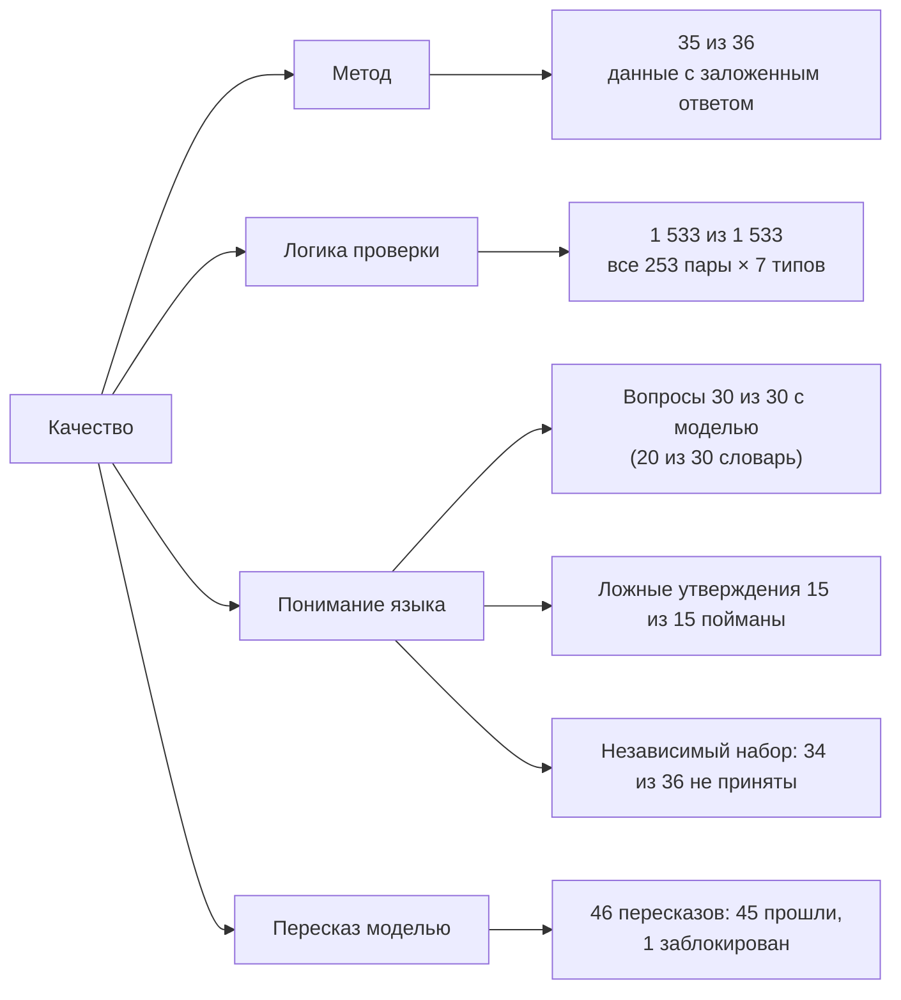
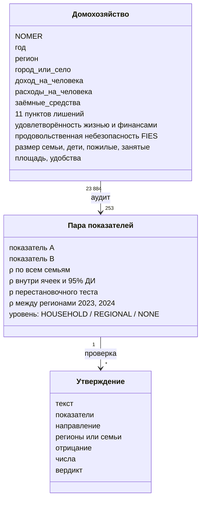

# Архитектура Provable

Provable — система проверки выводов из официальной статистики. Ниже: из чего она состоит, как проходят данные, как выносится вердикт и как проверено качество. Диаграммы рисуются прямо на GitHub.

## 1. Компоненты

| Компонент | Что делает |
|---|---|
| `build_dataset.py` | сшивает формы по ключу `NOMER` в панель домохозяйство × год: доходы, лишения, удовлетворённость, состав семьи, жильё |
| `engine.py` | ранговая корреляция по всем семьям и внутри ячеек регион × город/село × год, перестановочный тест, бутстрап, региональный тест на двух годах; разбор вопросов; проверка чисел в тексте |
| `findings.py` | применяет движок ко всем 253 парам показателей и проверяет главную находку на устойчивость |
| `provable.html` | интерфейс: вопросы, проверка утверждений и записок, генерация записки, библиотека выводов, графики |
| `serve.py` + `llm_api.py` | ИИ-режим: модель понимает вопросы и пересказывает вердикты; всё, что она вернула, проверяется кодом |
| `export_bns.py` | Excel для сотрудника без программирования |

## 2. Главный принцип: модель не считает

Числа и вердикты всегда считает движок. Модель только понимает текст и пересказывает результат, и оба её выхода проверяются кодом.

## 3. Как выносится вердикт

## 4. Вопрос в ИИ-режиме

Без интернета или без `serve.py` приложение использует словарь (русский и казахский) и работает так же, только без пересказа.

## 5. Проверка записки

Утверждения проверяются только правилами, без языковой модели: на контрольном наборе с моделью проскочило одно ложное утверждение, без неё — ни одного.

## 6. Конвейер `run_all.sh`

Новые микроданные → та же команда → новые вердикты. Ни одно число в коде не задано вручную.

## 7. Как проверено качество

Подробности и ограничения каждого замера — в [eval/README.md](../eval/README.md).

## 8. Структура данных

